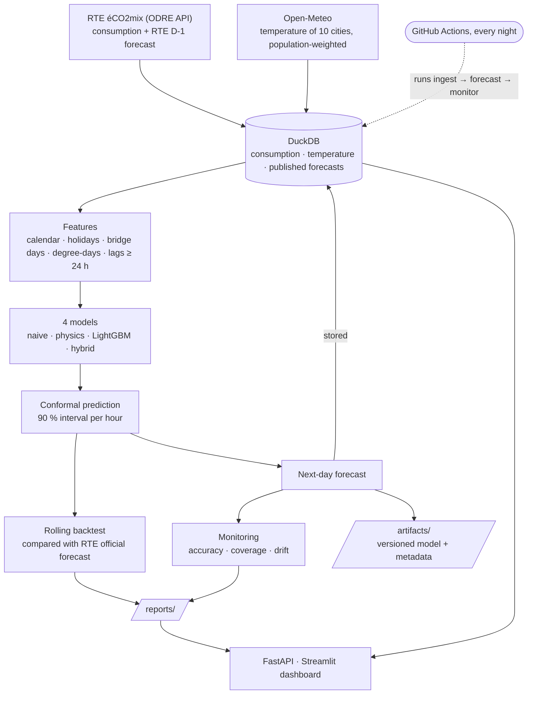
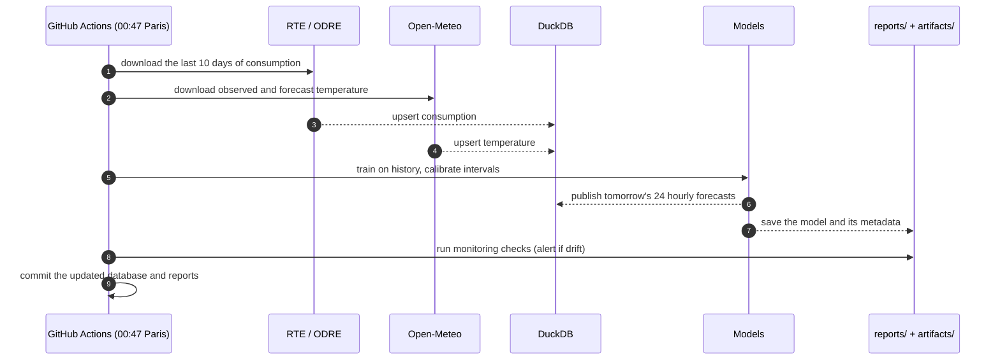

# ⚡ GridCast FR

**Day-ahead forecast of French electricity consumption, with calibrated uncertainty and drift monitoring.**

Every night, GridCast downloads the national consumption published by RTE and the weather of the 10 largest French urban areas, then publishes the forecast of the next 24 hours with a 90 % prediction interval. A dashboard compares each forecast with reality, and automatic checks raise an alert when the model stops being trustworthy.

> 🔗 Live dashboard: _add your Streamlit link here_ · 🔗 API docs: _add your link here_

<!-- Add a screenshot of YOUR dashboard on real data: docs/dashboard.png -->

---

## Why this project

Grid operators and energy suppliers must know tomorrow's demand to plan production. A single number is not enough: a planner needs to know **how sure** the forecast is. This project answers three questions:

1. **How much** electricity will France consume tomorrow, hour by hour?
2. **How confident** are we? Every forecast comes with an interval that contains the real value 90 % of the time.
3. **Can we still trust the model today?** Accuracy, calibration and input drift are checked every day.

## Results

> ⚠️ Fill this table with **your own** backtest on real RTE data (`python -m gridcast.cli backtest --weeks 52`).
> Never report results obtained on the synthetic demo data.

| Model | MAE (MW) | MAPE (%) | MAPE < 5 °C (%) | 90 % interval coverage | Mean width (MW) |
|---|---|---|---|---|---|
| Seasonal naive (same hour last week) | | | | | |
| Thermal physics model | | | | | |
| LightGBM (data-driven) | | | | | |
| **Hybrid (physics + LightGBM)** | | | | | |
| *RTE official day-ahead forecast (benchmark)* | | | | – | – |

The last row is RTE's own forecast, published the day before on éCO2mix. It is the professional reference: the goal is not to beat the grid operator, but to measure how close a transparent, reproducible pipeline gets.

**Physical insight learned from the data:** each degree of cold below 15 °C adds about **_X_ GW** of demand in France.

## Architecture



### What happens every night



### Models, from simple to hybrid

| Model | Idea | Why it is here |
|---|---|---|
| Seasonal naive | Same hour, one week before | The baseline every model must beat |
| Thermal physics | Linear model: daily profile + heating and cooling degree-days, with building inertia | Interpretable, every coefficient has a physical meaning |
| LightGBM | Gradient boosting on calendar, weather and lag features | Strong purely data-driven benchmark |
| **Hybrid** | Physics model + LightGBM trained on its residuals | Physics gives the structure, ML corrects what physics misses |
| *RTE official D-1* | The forecast published by the grid operator | External professional benchmark, never used as an input |

### Honest evaluation
- **Rolling-origin backtest:** for each test week, models are trained only on the past, calibrated on the next 8 weeks they have never seen, then evaluated on the following week. Exactly what would have happened in production.
- **Day-ahead rule:** every feature is known at midnight before the target day (consumption lags ≥ 24 h, forecast temperature for future hours). A unit test checks that no feature leaks the future.
- **Professional benchmark:** RTE's official day-ahead forecast is scored on the same hours with the same metrics.
- **Robustness:** errors are also reported on cold hours (< 5 °C), when the grid is under stress.

### Calibrated uncertainty
Split conformal prediction, conditional on the hour of the day: the 90 % quantile of out-of-sample errors on the calibration window gives a margin with a coverage guarantee and no assumption on the error distribution. Night errors and evening-peak errors get different margins.

### Monitoring
| Check | Alert when |
|---|---|
| Rolling MAPE (14 days) | above 1.5 × the backtest MAPE |
| Interval coverage | below 80 % for a 90 % target |
| Temperature out of training range | more than 5 % of recent hours |
| Error distribution drift | Kolmogorov-Smirnov p-value < 0.01 |

### Model registry
Every model used for a published forecast is saved in `artifacts/` (joblib) with a JSON file: training period, number of rows, target day and backtest MAPE. Any forecast can be traced back to the exact model that produced it, and reloaded to reproduce it.

## Quickstart

```bash
python -m venv .venv && source .venv/bin/activate     # Windows: .venv\Scripts\activate
python -m pip install -r requirements-dev.txt
export PYTHONPATH=src:.                               # Windows PowerShell: $env:PYTHONPATH="src;."

# Real data
python -m gridcast.cli ingest --start 2021-01-01      # RTE + Open-Meteo
python -m gridcast.cli backtest --weeks 52            # model comparison
python -m gridcast.cli replay --days 30               # past forecasts, to start monitoring
python -m gridcast.cli forecast                       # next day
python -m gridcast.cli monitor

# Dashboard and API
streamlit run app/dashboard.py
uvicorn api.main:app --reload                         # docs on http://localhost:8000/docs

# Tests
python -m pytest -q
```

No internet? `python -m gridcast.cli demo` loads synthetic data with the same structure, so the whole pipeline can run offline.

With Docker: `docker compose up --build` (API on port 8000, dashboard on 8501).

## Project structure

```
src/gridcast/
  data/rte.py        RTE eCO2mix download (ODRE API): consumption + RTE D-1 forecast, hourly resampling
  data/weather.py    Open-Meteo history and forecast, population-weighted national temperature
  data/store.py      DuckDB storage (consumption, temperature, every published forecast)
  data/synthetic.py  synthetic data for tests and offline demo
  features.py        calendar, French holidays and bridge days, degree-days, lags
  models.py          naive, thermal physics, LightGBM, hybrid
  conformal.py       hourly split conformal prediction
  evaluate.py        rolling-origin backtest, metrics, RTE benchmark
  monitoring.py      accuracy, coverage, out-of-range and drift checks
  registry.py        saves every trained model with its metadata
  pipeline.py        ingest, backtest, forecast, replay, monitor
  cli.py             command line
api/main.py          FastAPI service
app/dashboard.py     Streamlit dashboard
tests/               pytest: no future leakage, physics parameter recovery, conformal coverage, registry, API
.github/workflows/   CI tests on every push + nightly forecast job
reports/             backtest and monitoring results (created at run time)
artifacts/           versioned models (created at run time)
```

## Limitations and next steps
- Temperature only: adding cloud cover (lighting) and wind chill would help.
- The physics model uses fixed degree-day thresholds (15 °C / 22 °C); they could be estimated from data.
- Adaptive conformal inference would react faster after a regime change.
- Probabilistic models (quantile regression) could be compared to conformal intervals.

## Data sources
- RTE, éCO2mix national data, via the ODRE open-data portal (Licence Ouverte / Etalab).
- Open-Meteo weather API (CC BY 4.0).